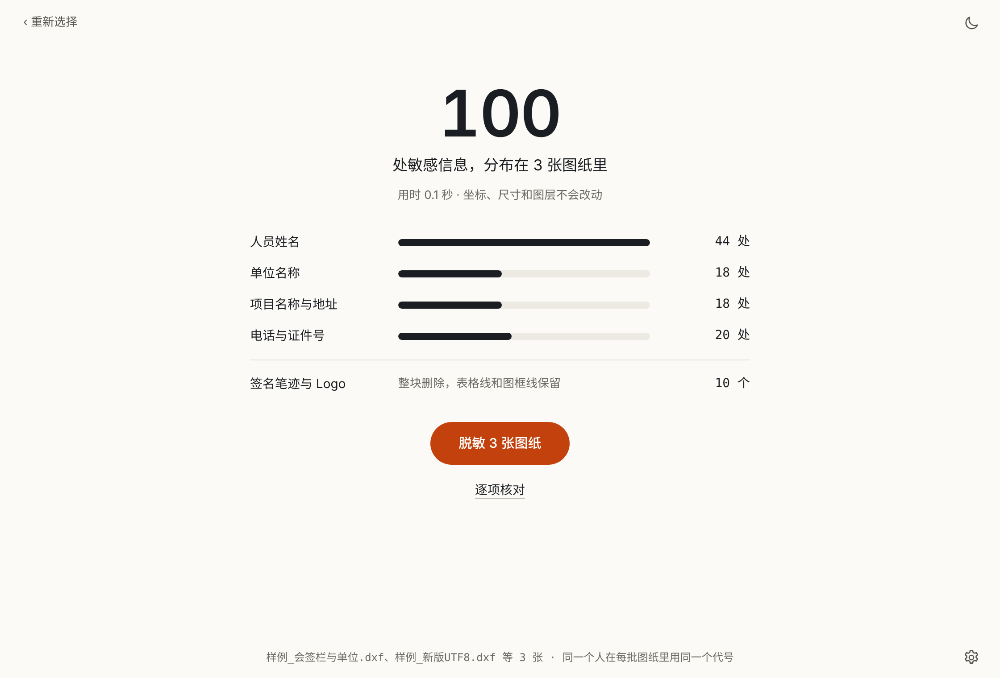
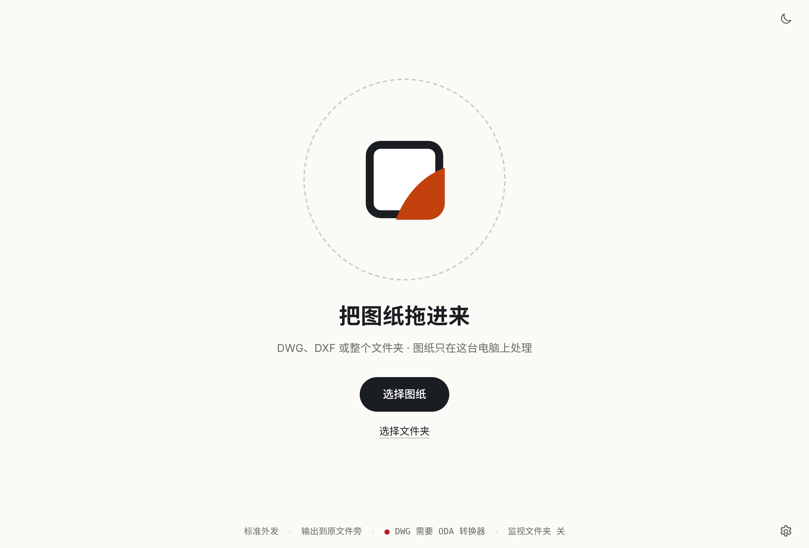
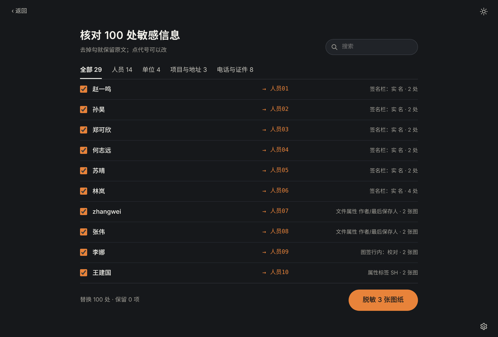

<p align="center"></p>

<h1 align="center">图隐 DrawVeil</h1>

<p align="center">CAD 图纸（DWG / DXF）信息脱敏工具：去掉人名、单位、项目、电话、签名和 Logo，坐标、尺寸、标注一处不动。</p>

<p align="center">
<a href="https://drawveil.limch.cc">网页版</a> ·
<a href="https://github.com/peter804762649-ux/drawveil/releases">下载桌面版</a> ·
<a href="docs/使用说明.md">使用说明</a> ·
<a href="#english">English</a>
</p>

<p align="center"></p>

## 为什么做这个

图纸发给外部单位、上传平台、交给 AI 或外包审图之前，图签、会签栏、说明文字和文件属性里往往带着设计人、审核人、建设单位、项目名称、电话、证书号，还有手写签名和单位 Logo。逐张手改很慢，也容易漏。图隐把这些都找出来，统一换成代号（人员01、单位01……），同时保证工程设计内容不变。

## 能做什么

- **认得出图签和会签栏**：“设计 / 校对 / 审核”旁边的名字、实名列里的名字，包括“孙　昊”这种中间加空格、或者每个字单独一个文字对象的写法。
- **全图找**：中英文单位名称、电话、邮箱、身份证号和统一社会信用代码（带校验位验证）、银行账号、网址，以及你自己补充的敏感词或正则。
- **删签名和 Logo**：签名栏里的手写笔迹、单位名称旁的 Logo 图形整块删除，表格线和图框线保留。
- **清文件属性**：作者、最后保存人、编辑时长、外部参照和打印机路径、缩略图、超链接。
- **前后一致**：同一个人在所有图层、图块、文件里都是同一个代号；桌面版还能让下一批图纸沿用上一批的代号。
- **处理完自动校验**：逐个比对每个图元的坐标、尺寸和角度，再在输出文件里复查有没有原文残留，结果写进报告。
- **原样保存**：没有改动的部分逐字节保持原样，DXF 的编码（UTF-8 / GBK）和版本不变。

<p align="center">


</p>

## 三种用法

| | 网页版 | 桌面版（Mac / Windows） | 命令行 |
|---|---|---|---|
| 怎么用 | 打开 [drawveil.limch.cc](https://drawveil.limch.cc) | [Releases](https://github.com/peter804762649-ux/drawveil/releases) 下载安装 | `python3 cad_desensitize.py run 图纸/` |
| DXF | ✓ | ✓ | ✓ |
| DWG | 先另存为 DXF | ✓（需装免费的 [ODA File Converter](https://www.opendesign.com/guestfiles/oda_file_converter)） | ✓（同左） |
| 批量 / 文件夹 | ✓ | ✓，还能监视文件夹自动处理 | ✓ |
| 图纸去哪了 | 只在你的浏览器里处理，不上传 | 只在本机处理 | 只在本机处理 |

主程序 `cad_desensitize.py` 只用 Python 3.8+ 标准库，网页版和桌面版都调用它。

## 使用前请注意

- **报告和代号对照表里有原文**，只能内部留存，不要和脱敏后的图纸一起发出去。
- 天正等软件的自定义对象（代理对象）里的文字，可能没法完全处理到，完成页会提示。这类图纸建议先在天正里“图纸导出”为 T3 格式再处理。
- 自动识别不可能百分之百准确，外发前请看一眼报告，必要时用“逐项核对”调整。

## 目录

```
cad_desensitize.py   脱敏引擎 + 命令行 + 简易本地网页界面
desktop/             桌面版（pywebview 原生窗口，PyInstaller 打包）
web/                 网页版（Pyodide 在浏览器里运行引擎，Cloudflare Workers 托管静态文件）
tests/               三张虚构样例图纸的生成脚本和回归测试
docs/                使用说明和截图
```

## 开发

```bash
python3 tests/run_tests.py                     # 回归测试
python3 tests/make_samples.py 样例图纸          # 生成三张虚构样例
python3 desktop/drawveil_desktop.py --browser  # 不装 pywebview，用浏览器打开桌面版界面
```

发布新版本：推送 `v1.2.3` 这样的标签，GitHub Actions 会自动打包 Mac（Apple 芯片、Intel）和 Windows 安装包并发布到 Releases。网页版部署见 [web/README.md](web/README.md)。

欢迎提 Issue 和 Pull Request。如果遇到识别不出或误识别的情况，最好附一张能复现问题、并且已经去掉真实信息的 DXF。

## 许可证

[MIT](LICENSE)

---

<a id="english"></a>

## English

**DrawVeil** removes sensitive information from CAD drawings (DWG / DXF) before you share them: people's names in title blocks and sign-off tables, company and project names (Chinese and English), phone numbers, emails, ID and business-license numbers, handwritten signature strokes, company logos and file metadata. Everything is replaced with consistent placeholders (人员01, 单位01, …), while geometry, dimensions and annotations stay untouched. Each output is verified entity by entity, and the tool checks that no original text remains.

- **Web**: <https://drawveil.limch.cc>. It runs fully in your browser via Pyodide, and drawings are never uploaded. DXF only.
- **Desktop** (macOS / Windows): download from [Releases](https://github.com/peter804762649-ux/drawveil/releases). It handles DWG through the free ODA File Converter and can watch a folder.
- **CLI**: `python3 cad_desensitize.py run drawings/` (Python 3.8+, standard library only).

The UI and docs are in Chinese. Licensed under MIT.
